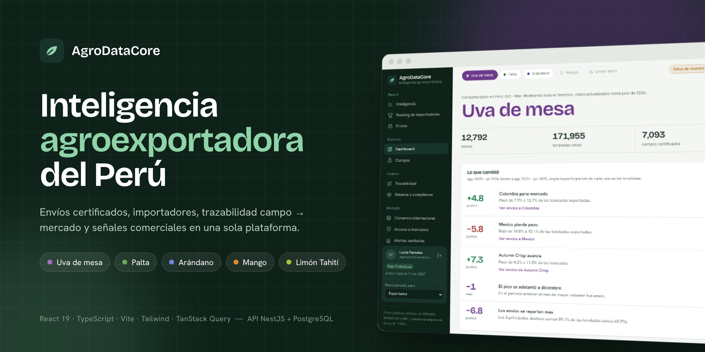
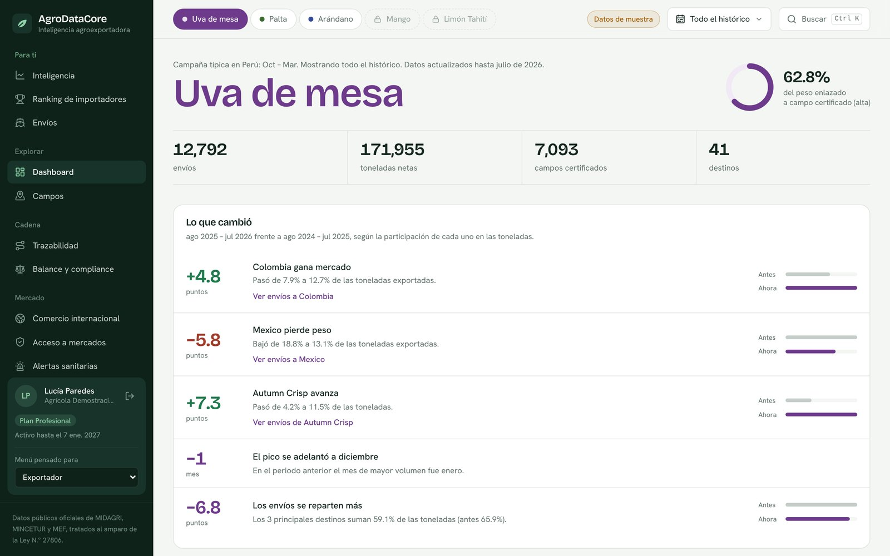
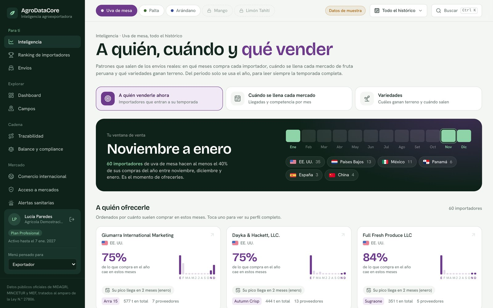
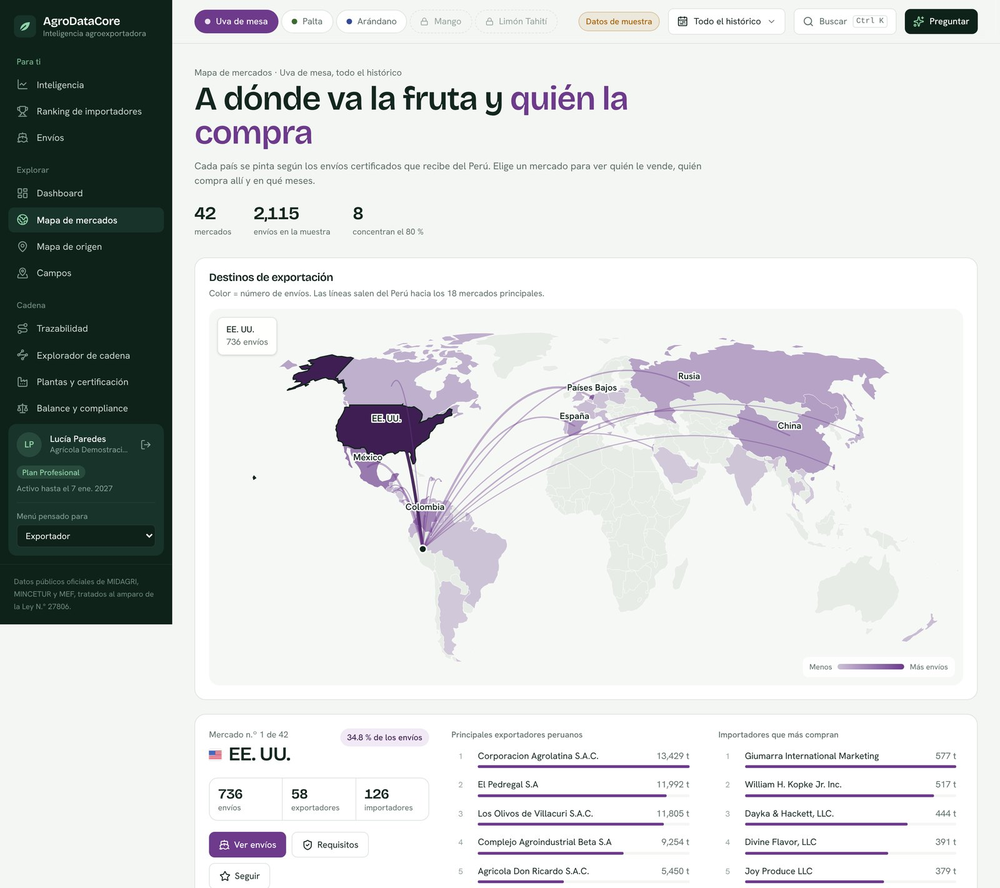
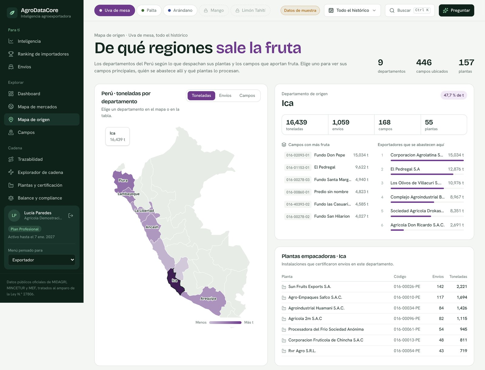
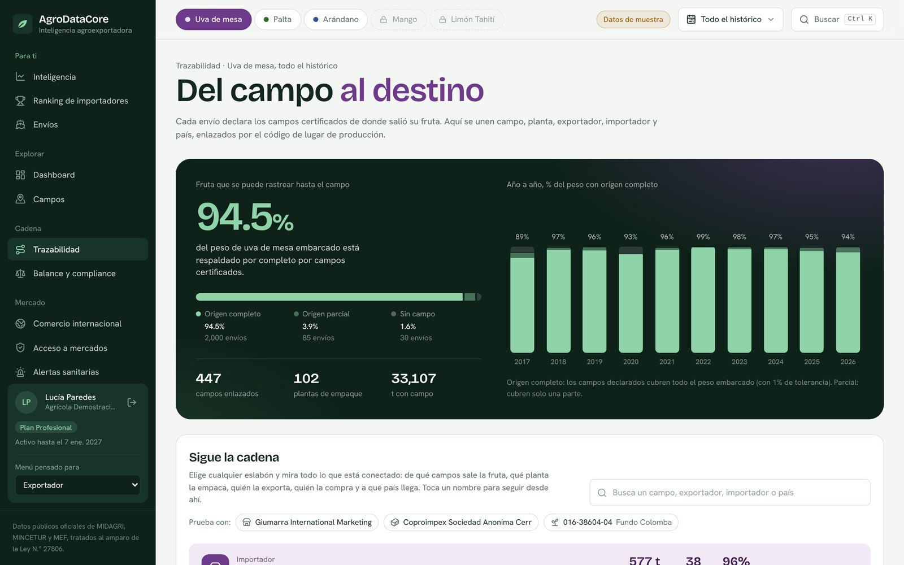
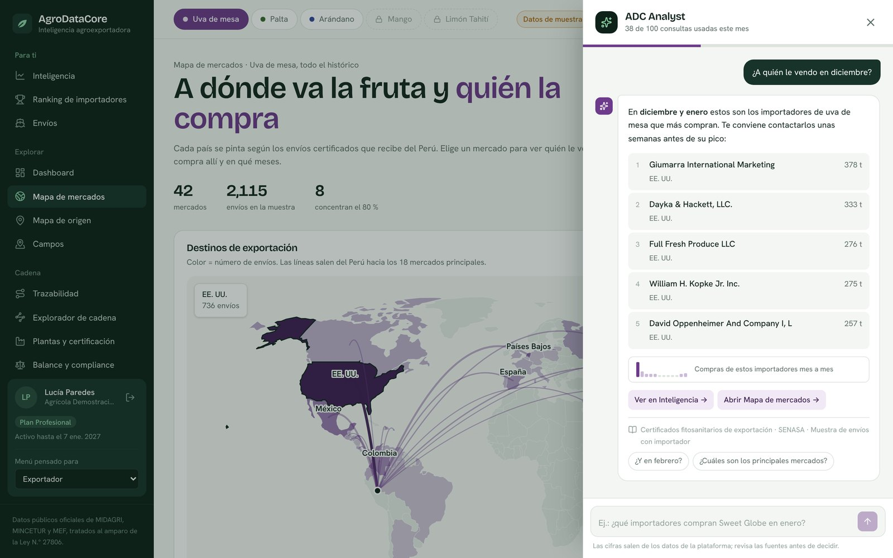
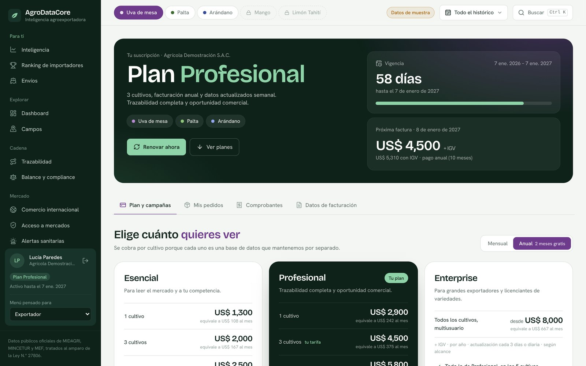
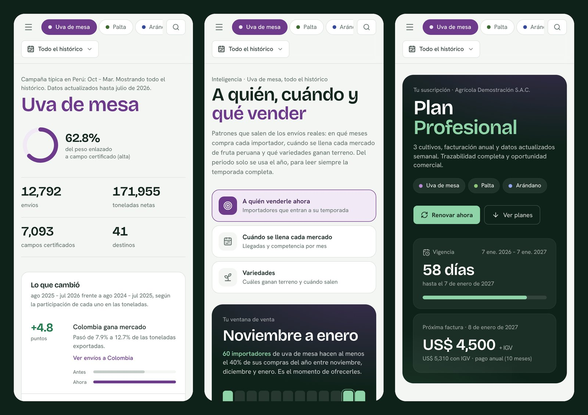

<p align="center">
  
</p>

<p align="center">
  
  
  
  
  
</p>

**AgroDataCore** reúne en una sola plataforma la información pública de la agroexportación peruana de **uva de mesa, palta, arándano, mango y limón Tahití**: envíos certificados, importadores, trazabilidad del campo al mercado, requisitos de acceso, alertas sanitarias y señales comerciales para decidir a quién vender, cuándo y qué.

Este repositorio contiene el **frontend** de la nueva versión y la **v55** (prototipo HTML anterior) como referencia.

---

## Vistazo

<table>
  <tr>
    <td width="50%"><br><sub><b>Resumen</b> · cifras del cultivo y lo que cambió frente al periodo anterior</sub></td>
    <td width="50%"><br><sub><b>Inteligencia</b> · a quién venderle, cuándo y qué variedad</sub></td>
  </tr>
  <tr>
    <td><br><sub><b>Mapa de mercados</b> · destinos, exportadores e importadores de cada país</sub></td>
    <td><br><sub><b>Mapa de origen</b> · departamentos, campos y plantas empacadoras</sub></td>
  </tr>
  <tr>
    <td><br><sub><b>Trazabilidad</b> · del campo certificado al importador</sub></td>
    <td><br><sub><b>ADC Analyst</b> · preguntas en lenguaje natural con fuentes citadas</sub></td>
  </tr>
  <tr>
    <td><br><sub><b>Suscripción</b> · planes, pedidos, comprobantes y facturación</sub></td>
    <td><br><sub><b>Celular</b> · toda la plataforma se adapta a pantallas pequeñas</sub></td>
  </tr>
</table>

---

## Módulos

| Área | Módulos |
|---|---|
| **Explorar** | Dashboard · Mapa de mercados · Mapa de origen · Envíos · Ranking de importadores · Campos |
| **Cadena** | Trazabilidad · Explorador de cadena · Plantas y certificación · Balance y compliance |
| **Mercado** | Inteligencia · Comercio internacional · Acceso a mercados · Alertas sanitarias (RASFF) · Alertas fitosanitarias |
| **Reportes y cuenta** | Informe visual · Comparador · Mi seguimiento · Suscripción |
| **En toda la plataforma** | Asistente ADC Analyst · Búsqueda universal (Ctrl K) · Menú por tipo de usuario · Planes Esencial / Profesional / Enterprise |

## Fuentes de datos

Solo fuentes públicas y oficiales:

- **SENASA** · certificados fitosanitarios de exportación y lugares de producción (CLP)
- **SUNAT – ADUANET** · declaraciones de exportación
- **PROMPERÚ / MINCETUR** · estadísticas de comercio exterior y acceso a mercados
- **FAOSTAT** · producción y comercio mundial (CC BY 4.0, © FAO)

Los datos personales se tratan según la **Ley N.° 29733** de Protección de Datos Personales.

---

## Cómo ejecutarlo

Requisitos: **Node.js 20 o superior**.

```bash
git clone https://github.com/DanteCarranza/AGRODATA.git
cd AGRODATA
npm install
cp .env.example .env      # en Windows: copy .env.example .env
npm run dev               # abre http://localhost:5173
```

Mientras el backend no esté en línea, la app usa los datos de muestra de `src/mocks` (`VITE_USE_MOCKS=true`). Para entrar, usa cualquiera de las **cuentas de demostración** de la pantalla de ingreso.

| Comando | Para qué |
|---|---|
| `npm run dev` | Servidor de desarrollo |
| `npm run build` | Compilación para producción en `dist/` |
| `npm run preview` | Sirve la compilación localmente |
| `npm run lint` | Revisión de código con ESLint |
| `npm run mocks -- "ruta\prototipo.html"` | Regenera los datos de muestra desde un HTML de la v55 |

### Variables de entorno

| Variable | Valor por defecto | Descripción |
|---|---|---|
| `VITE_API_URL` | `/api` | URL base del backend NestJS |
| `VITE_USE_MOCKS` | `true` | `true` usa `src/mocks`; `false` llama al backend real |

## Estructura

```
src/
├── components/   layout (menú, barra superior, bloqueo por plan) y piezas de interfaz (mapas, paneles, barras)
├── config/       cultivos, menú, planes y permisos por ruta
├── features/     un módulo por carpeta: página + hooks de datos + componentes
├── mocks/        implementación en el navegador de cada endpoint del backend
├── lib/          API, formatos, exportación CSV, utilidades
├── store/        estado global (filtros, avisos, asistente)
└── types/        contratos de datos compartidos con el backend
legacy/v55/       prototipo HTML anterior, como referencia
docs/img/         imágenes de este README
```

Cada módulo pide sus datos con un hook (`useX`) que llama a `GET /api/...`. Mientras `VITE_USE_MOCKS=true`, el mismo hook responde desde `src/mocks/x.mock.ts`, que devuelve **exactamente la forma** que debe devolver el backend.

## Hoja de ruta

- [x] Frontend nuevo con los módulos principales de la v55
- [x] Cuentas, planes, avisos de vencimiento, pedidos y comprobantes (en el navegador)
- [ ] Backend NestJS + PostgreSQL con las mismas rutas que `src/mocks`
- [ ] Robot de captura de fuentes oficiales con actualización semanal
- [ ] Servidor de IA para el asistente ADC Analyst
- [ ] Pasarela de pago y facturación electrónica
- [ ] Aula virtual (Moodle) con inicio de sesión único

---

<sub>© 2026 Dante Carranza Segura. Todos los derechos reservados.</sub>